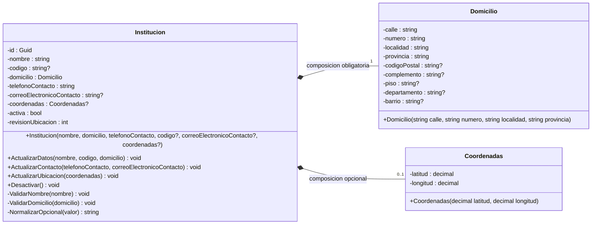

# 1 Diagrama de Clases - Modulo Configuracion (Domain)

> **Convencion:** El diagrama representa los campos internos (backing fields). Las propiedades publicas de C# se omiten. Usamos `-` para campos privados, `+` para metodos publicos y `-` para metodos privados.



---
## 2. Qué significa cada dato de Institucion

Esta sección explica para qué existe cada dato y qué acepta el código actual. No debemos confundir un tipo de C# con una validación de negocio completa.

| Dato | Qué representa | Comportamiento actual |
|---|---|---|
| `Id` | Identificador interno del jardín. | El constructor genera un Guid. La propiedad solo permite lectura y no cambia al actualizar los demás datos. |
| `Nombre` | Nombre que reconoce el personal. | Rechaza null, texto vacío o solo espacios. Trim quita espacios al principio y al final; conserva los espacios internos. |
| `Codigo` | Código institucional externo, diferente del Id. | Es opcional. Un valor vacío o de espacios se guarda como null; no hay validación de formato ni unicidad. |
| `Domicilio` | Dirección del establecimiento. | Exige recibir un objeto no nulo. Eso no garantiza que todos sus campos estén completos ni que la dirección exista. |
| `TelefonoContacto` | Teléfono del jardín. | Rechaza null y recorta espacios exteriores. Todavía acepta texto vacío y no valida el formato. |
| `CorreoElectronicoContacto` | Correo para contactar al jardín. | Es opcional. Un valor vacío se guarda como null; todavía no comprueba el formato de correo. |
| `Coordenadas` | Punto geográfico del establecimiento. | Puede estar pendiente. Cuando se recibe un objeto, Coordenadas ya comprobó los rangos numéricos de latitud y longitud. |
| `Activa` | Estado activo o inactivo del jardín. | Comienza en true. Desactivar lo cambia a false. Todavía no se definieron ni implementaron todas las restricciones asociadas a ese estado. |
| `RevisionUbicacion` | Contador para reconocer cambios de domicilio o coordenadas. | Comienza en 1 y aumenta cuando se asignan valores distintos. No es una versión del algoritmo de distancia y no recalcula nada. |

### Id y Codigo no son lo mismo

Ejemplo ficticio:

```text
Id:     7e6dba39-4f61-4a9b-8cc5-9a2f75c01483
Codigo: JARDIN-123
Nombre: Jardín Las Flores
```

El Id lo genera el sistema. El Codigo es una referencia externa que puede cargar el personal.

Si cambia el nombre del jardín, conserva su Id. Dos instituciones pueden tener el mismo nombre; no usamos ese nombre para distinguir sus registros.

### Domicilio y Coordenadas tampoco son lo mismo

Domicilio describe una dirección con palabras y números: calle, altura, localidad y provincia. Coordenadas describe un punto geográfico.

Conocer la dirección no significa haber identificado correctamente el punto. Por eso permitimos registrar el jardín con las coordenadas pendientes.

`Domicilio` y `Coordenadas` se modelan como **objetos de valor**: no tienen un Id propio y se comparan por sus datos. Sus propiedades solo tienen get, de modo que no se modifican después de construirlos.

Son `sealed record`: sealed impide crear tipos derivados; record aporta comparación por valores. La falta de escritura en sus propiedades es lo que impide cambiarlas directamente.

Ninguno consulta Geoapify. La futura integración externa pertenecerá a Infrastructure.

## 3. Qué hace el constructor

El constructor establece el estado inicial de un objeto Institucion. Crear ese objeto en memoria todavía no lo guarda en PostgreSQL.

Recibe nombre, domicilio y teléfono. También permite recibir código, correo y coordenadas como datos opcionales.

El código actual realiza estos pasos:

1. Comprueba que el nombre no esté vacío y que exista un objeto Domicilio.
2. Comprueba que el teléfono no sea null.
3. Genera el Id.
4. Asigna los datos y limpia los espacios exteriores según corresponda.
5. Asigna las coordenadas recibidas, o null si no se proporcionaron.
6. Establece Activa en true y RevisionUbicacion en 1.

Ejemplo de estado inicial:

```text
Nombre: Jardín Las Flores
Domicilio: una dirección cargada
Coordenadas: pendientes
Activa: true
RevisionUbicacion: 1
```
